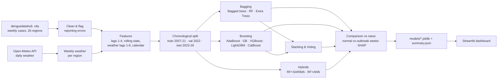

# Sri Lanka Dengue Early-Warning Dashboard: Ensemble Learning

**CM4371 Machine Learning & Pattern Recognition · Hands-on project · B. G. M. Prabuddhi**

🔗 **Live dashboard:** _LIVE_URL_PLACEHOLDER_ · 🎥 **Video (≤ 3 min):** _VIDEO_URL_PLACEHOLDER_ · 💻 **Code:** https://github.com/BGMPrabuddhi/SriLanka-Dengue-Ensemble

Dengue is one of Sri Lanka's largest public-health burdens: in the record year 2017 the Epidemiology Unit recorded
**174,687 cases**, with a peak of **10,590 cases in a single week**. Every week, case counts arrive for 26 health regions,
but decisions about where to send fogging teams, hospital capacity and awareness campaigns have to be made *before* the
next week's cases appear. This project uses weekly district-level dengue data plus lagged weather to **forecast next week's
cases in every region**, turns the forecast into a **Low / Medium / High risk level**, and compares **bagging, boosting,
stacking and hybrid** models to find out which forecaster is most reliable, and *why*.

---

## Problem statement
*Regression:* standing at the end of reporting week *t*, predict the number of dengue cases in week *t+1* for each of the
26 Regional Director of Health Services (RDHS) areas. The forecast is converted into a risk level using each region's
own history (above its 75th percentile = High, 50th–75th = Medium, otherwise Low). Every model must beat the naive
forecast *"next week = this week"*.

## Data (all real, Sri Lankan, publicly available)
| Source | What | Coverage |
|---|---|---|
| **denguedatahub** R package (Talagala, T. S.), dataset `srilanka_weekly_data`, from the Weekly Epidemiological Reports of the Epidemiology Unit, Ministry of Health | weekly dengue cases for 26 RDHS areas | 23 Dec 2006 – 13 Sep 2026 (26,753 rows) |
| **Open-Meteo Historical Weather API** (ERA5 reanalysis) | daily rainfall, mean temperature, mean relative humidity at each region's main town, aggregated to the reporting weeks | same period |

The `.rda` file is downloaded automatically and read with `pyreadr`; weather is cached in `data/raw/weather.csv`.

**Data quality.** Cleaning standardised spelling variants (e.g. `Kalmune` → Kalmunai, mapped to Ampara for weather), unified
two date formats, and rebuilt year/week from dates (the source labels are wrong around New Year). **570 district-weeks
(2.1%) were flagged as reporting errors and kept as missing, never invented:** whole missing years (northern regions
2007–09, Monaragala 2020), a national reporting gap (10 Sep 2022), single-week drop-outs, four weeks that are exact copies
of the previous week, and two 2026 weeks in which counts were assigned to the wrong regions. **Outliers:** 3.8% of
region-weeks are extreme by a per-district IQR rule, but 77% fall in the epidemic years 2017, 2019, 2023 and 2026, and 79%
occur while at least 3 regions are extreme together. They are real outbreaks, so they are kept (skewness is handled with a
log1p target) and only reporting errors are flagged.

## Pipeline


## Methods
* **Features (per region, no leakage):** cases in weeks *t … t−3*, 4- and 8-week rolling mean / std, a was-missing count,
  rainfall / temperature / humidity lagged 1–8 weeks (EDA showed rain and humidity lead cases by ~7–9 weeks), cyclical
  week-of-year, year, one-hot region. Gaps inside the lag window are forward-filled within the region.
* **Validation:** strictly chronological. Train 2007–2021, validation 2022, test 31 Dec 2022 – 24 Aug 2026 (the latest
  2 weeks are excluded because they may still be revised). Hyper-parameters tuned with `RandomizedSearchCV` +
  `TimeSeriesSplit`; preprocessing inside sklearn `Pipeline`s; `random_state = 42` everywhere. Models are **selected on
  validation MAE**, never on test.
* **Target:** log1p(cases), chosen on validation MAE (notebook 02); predictions converted back with `expm1`.
* **Bagging** (variance reduction): `BaggingRegressor(DecisionTree)`, `RandomForestRegressor` (with OOB score),
  `ExtraTreesRegressor`.
* **Boosting** (bias reduction): `AdaBoostRegressor`, `GradientBoostingRegressor`, `XGBRegressor`, `LGBMRegressor`,
  `CatBoostRegressor`, each with early stopping on 2022.
* **Stacking:** RF + XGBoost + LightGBM + CatBoost → `RidgeCV`, with *time-ordered* out-of-fold predictions (a small custom
  class, because sklearn's `StackingRegressor` does not accept `TimeSeriesSplit`); plus a `VotingRegressor`.
* **Hybrids:** (1) **RF + SARIMA**: SARIMA(1,0,1)(1,0,1)₅₂ chosen by AIC, Random Forest on its residuals, walk-forward
  one-step-ahead, for the national total and Colombo; (2) **RF + ANN**: MLP on log-scaled inputs combined with RF by a
  validation-tuned weighted average, and by feeding RF's out-of-fold forecast into the ANN.
* **Evaluation:** MAE, RMSE, R², sMAPE, training time, **% improvement over naive**, and MAE split into **normal vs outbreak
  weeks** (actual above the region's training 75th percentile).

## Results (test period 2023–2026, 4,854 region-weeks)

### Core comparison: Bagging vs Boosting vs Stacking
| Strategy | Model | Test MAE | vs naive | MAE normal weeks | MAE outbreak weeks |
|---|---|---|---|---|---|
| Baseline | Naive (next week = this week) | 14.95 | — | 7.43 | 21.06 |
| **Bagging** | Random Forest | 14.52 | +2.9% | 6.07 | 21.39 |
| **Boosting** | XGBoost | 16.51 | −10.4% | 5.93 | 25.11 |
| **Stacking** | RF + XGBoost + LightGBM + CatBoost → RidgeCV | **14.23** | **+4.8%** | 6.69 | **20.37** |

* **Bagging** averages hundreds of deep trees (lower variance): 18% better than naive in normal weeks, level in outbreaks.
* **Boosting** removes bias step by step and is the most accurate in calm weeks, but under-forecasts surges. The cause is
  the log-cases target, not boosting: the same XGBoost trained on raw cases scores **14.37** (+3.9%, better than Random
  Forest). Log-cases was chosen on the calm 2022 validation year, which hid this cost; we report it rather than switch
  after seeing the test set.
* **Stacking** wins even though the base models' errors are 98% correlated: its meta-learner weights sum to 1.05, lifting
  forecasts and correcting part of the shared outbreak under-forecast (best outbreak-week error of the three).


### All models
| Family | Model | Test MAE | Test RMSE | R² | MAE vs naive | MAE normal wks | MAE outbreak wks | Val MAE (2022) |
|---|---|---|---|---|---|---|---|---|
| Baseline | Naive (last week) | 14.95 | 37.59 | 0.867 | +0.0% | 7.43 | 21.06 | 11.55 |
| Baseline | Seasonal naive (last year) | 37.75 | 95.69 | 0.140 | -152.5% | 17.63 | 54.12 | 20.11 |
| Bagging | **Extra Trees** ⭐ deployed | **14.51** | 39.09 | 0.857 | +3.0% | 6.20 | 21.26 | **10.34** |
| Bagging | Random Forest | 14.52 | 37.47 | 0.868 | +2.9% | 6.07 | 21.39 | 10.39 |
| Bagging | Bagging (Decision Trees) | 14.70 | 38.28 | 0.862 | +1.7% | 6.03 | 21.75 | 10.45 |
| Boosting | Gradient Boosting | 15.45 | 43.01 | 0.826 | -3.3% | 5.89 | 23.22 | 10.43 |
| Boosting | CatBoost | 15.71 | 44.10 | 0.817 | -5.1% | 6.14 | 23.50 | 10.56 |
| Boosting | AdaBoost | 16.02 | 47.36 | 0.789 | -7.2% | 6.33 | 23.90 | 10.48 |
| Boosting | XGBoost | 16.51 | 51.89 | 0.747 | -10.4% | 5.93 | 25.11 | 10.44 |
| Boosting | LightGBM | 18.59 | 50.95 | 0.756 | -24.4% | 5.98 | 28.85 | 10.58 |
| Stacking | Stacking (RF+XGB+LGBM+Cat → Ridge) | 14.23 | 36.88 | 0.872 | +4.8% | 6.69 | 20.37 | 10.46 |
| Stacking | Voting (RF+XGB+LGBM+Cat, mean) | 15.61 | 43.19 | 0.825 | -4.4% | 5.87 | 23.53 | 10.41 |
| Neural net | ANN (MLP) | 17.44 | 65.87 | 0.593 | -16.7% | 6.89 | 26.02 | 10.94 |
| Hybrid | **Hybrid RF+ANN (weighted 0.8/0.2)** 🏆 best on test | **14.19** | 36.89 | 0.872 | **+5.1%** | 6.00 | 20.85 | 10.36 |
| Hybrid | Hybrid RF→ANN (RF as input) | 16.38 | 53.63 | 0.730 | -9.5% | 6.45 | 24.45 | 10.77 |

⭐ **Deployed model** = lowest validation MAE (the rule fixed before testing): **Extra Trees**.
🏆 **Best on test** = **Random Forest + neural network hybrid**.

RF + SARIMA hybrid (single weekly series, walk-forward one-step-ahead):

| Series | Naive | SARIMA alone | RF alone | **Hybrid RF+SARIMA** |
|---|---|---|---|---|
| National total (MAE, cases/week) | 210.7 | 214.8 (−2.0%) | 248.4 (−17.9%) | **202.2 (+4.0%)** |
| Colombo (MAE) | 58.1 | 60.5 (−4.1%) | 62.6 (−7.7%) | 62.0 (−6.6%) |

## Key findings: which approach performed best, and why
1. **Persistence is king.** Weekly cases have a lag-1 autocorrelation of 0.89, so "same as last week" (MAE 14.95) is a
   tough benchmark; recent cases carry ~85% of the models' SHAP attribution, weather ~8%.
2. **Bagging is the most reliable single family** (+3% vs naive). Averaging hundreds of deep trees reduces variance: forecasts
   are 17–19% more accurate than naive in normal weeks and level with naive in outbreak weeks.
3. **Boosting is best in calm weeks but worst in outbreaks** (−3% to −24%). The main cause is the log1p target: it makes
   boosted forecasts of big outbreaks too low (retransformation bias). On raw cases XGBoost scores 14.37 instead of 16.51
   and LightGBM 14.60 instead of 18.59. Only 0.4% of test weeks exceeded a region's training maximum, so "trees cannot
   extrapolate" is a minor factor.
4. **Combining models helps when it corrects that shared under-prediction.** Base models' errors are 98% correlated, so
   voting gains nothing (−4.4%), but stacking's meta-weights sum to 1.05 and scale forecasts up (+4.8%); the RF + ANN hybrid
   (+5.1%, best on test) blends a forest that forecasts too low with a network that can over-shoot. RF + SARIMA beats naive
   on the national total (+4.0%) while each part alone does not.
5. **Model selection needs outbreak years in validation.** The calm 2022 validation year picked Extra Trees; multi-year
   time-series CV ranks Random Forest first; the test favours combinations. Validation-vs-test rank correlation: 0.74.

The full discussion (bias–variance, stacking diversity, distribution shift, log1p effect, the 5–9 week weather lag and
its biology) is in [reports/ANALYSIS.md](reports/ANALYSIS.md), together with research
notes on **RF vs XGBoost / LightGBM / CatBoost** and **tree ensembles on tabular vs image/text data**.

## Dashboard
Seven pages: **Home** (situation overview, KPIs, early-warning signals, national trend), **Explore the data** (year and
region filters, trends over time, region-wise totals, seasonality, year × region heatmap, summary statistics),
**District forecast & risk** (next-week forecast, risk badge, early-warning indicators, all-region table), **Model
comparison** (bagging vs boosting vs stacking first, then all models, normal vs outbreak errors, actual-vs-predicted, "which
approach and why"), **Hybrid models**, **Explainability & what-if** (SHAP, live prediction from sliders), **About**
(sources, limitations, AI-use disclosure). Risk on the dashboard uses *recent-baseline* thresholds (each region's last 3
years); evaluation used training-only thresholds. Forecasts are labelled as model estimates, not reported cases.

| Home | District forecast | Model comparison |
|---|---|---|
| _screenshot placeholder_ | _screenshot placeholder_ | _screenshot placeholder_ |

## How to run locally
```powershell
git clone https://github.com/BGMPrabuddhi/SriLanka-Dengue-Ensemble.git
cd SriLanka-Dengue-Ensemble
python -m venv .venv                      # Python 3.12
.\.venv\Scripts\Activate.ps1              # macOS/Linux: source .venv/bin/activate
pip install -r requirements.txt           # enough for the dashboard
streamlit run app/app.py
```
To re-run the analysis: `pip install -r requirements-dev.txt`, then run the notebooks in order (01 → 07) or
`jupyter nbconvert --to notebook --execute --inplace notebooks/*.ipynb`. Notebook 01 downloads the data; the whole pipeline
takes roughly 25 minutes on a laptop.

**Python version:** models were trained with **Python 3.12** and the exact library pins in `requirements.txt`. When deploying
on Streamlit Community Cloud, choose **Python 3.12** under *Advanced settings* so the saved `.joblib` models load with the
same versions.

## Repository structure
```
SriLanka-Dengue-Ensemble/
├── app/app.py                 Streamlit dashboard
├── .streamlit/config.toml     dashboard theme
├── data/raw/                  downloaded dengue (.rda/.csv) and weather (cached API response)
├── data/processed/            cleaned data, feature table, forecast inputs, feature_config.json
├── models/                    *.joblib models, results.csv, predictions, registry.json, summary.json
├── notebooks/01 … 07          data & EDA → features → bagging → boosting → stacking → hybrids → final comparison (code + outputs)
├── reports/ANALYSIS.md         written analysis: key findings, why the models behaved this way, research notes
├── reports/figures/           all figures used in notebooks and the dashboard
├── src/                       config, data, features, models, evaluate, hybrid, viz (imported by notebooks & app)
├── requirements.txt           runtime pins (dashboard + model loading)
├── requirements-dev.txt       + notebooks, SHAP, data download
├── AI_DISCLOSURE.md · VIDEO_SCRIPT.md · README.md
```

## Limitations & future work
* One-week horizon only; planners often need 2–4 weeks of lead time (multi-step forecasting is the next step).
* Recent weeks may be revised by late reports; the source contains reporting errors that simple rules may not all catch.
* No data on mosquito surveys, dengue serotypes, population (cases are counts, not incidence) or human mobility.
* Weather from one grid point per region; models trained on 2007–2021 only (production use should retrain on all data).
* Validation used one calm year; rolling-origin validation over several seasons would select models more robustly.
* Future work: incidence per 100,000, quantile/interval forecasts for alert thresholds, raw-target or bias-corrected
  boosting, spatial features from neighbouring regions.

## AI-use disclosure
This project was developed **with the help of generative AI (Claude Code by Anthropic, in VS Code; Claude chat for
planning)**. AI generated most of the code, notebooks, dashboard and documentation drafts. The student (B. G. M. Prabuddhi)
chose the problem and data, set the requirements, made or approved the data and modelling decisions, reviewed and ran all
code, and interpreted the results. Every source file and notebook carries a disclosure note; details are in
[AI_DISCLOSURE.md](AI_DISCLOSURE.md).

## References
* Talagala, T. S. *denguedatahub: A Tidy Format Datasets of Dengue by Country.* R package. https://github.com/thiyangt/denguedatahub
* Epidemiology Unit, Ministry of Health, Sri Lanka. *Weekly Epidemiological Report.* https://www.epid.gov.lk
* Zippenfenig, P. (2023). *Open-Meteo.com Weather API.* https://open-meteo.com · Hersbach, H. et al. (2020). The ERA5 global reanalysis. *QJRMS*, 146, 1999–2049.
* Breiman, L. (1996). Bagging predictors. *Machine Learning*, 24, 123–140. · Breiman, L. (2001). Random forests. *Machine Learning*, 45, 5–32.
* Geurts, P., Ernst, D., Wehenkel, L. (2006). Extremely randomized trees. *Machine Learning*, 63, 3–42.
* Freund, Y., Schapire, R. (1997). A decision-theoretic generalization of on-line learning and an application to boosting. *JCSS*, 55, 119–139.
* Friedman, J. (2001). Greedy function approximation: a gradient boosting machine. *Annals of Statistics*, 29, 1189–1232.
* Chen, T., Guestrin, C. (2016). XGBoost. *KDD*. · Ke, G. et al. (2017). LightGBM. *NeurIPS*. · Prokhorenkova, L. et al. (2018). CatBoost. *NeurIPS*.
* Wolpert, D. (1992). Stacked generalization. *Neural Networks*, 5, 241–259.
* Zhang, G. P. (2003). Time series forecasting using a hybrid ARIMA and neural network model. *Neurocomputing*, 50, 159–175.
* Lundberg, S., Lee, S.-I. (2017). A unified approach to interpreting model predictions (SHAP). *NeurIPS*.
* Grinsztajn, L., Oyallon, E., Varoquaux, G. (2022). Why do tree-based models still outperform deep learning on tabular data? *NeurIPS Datasets & Benchmarks*.
