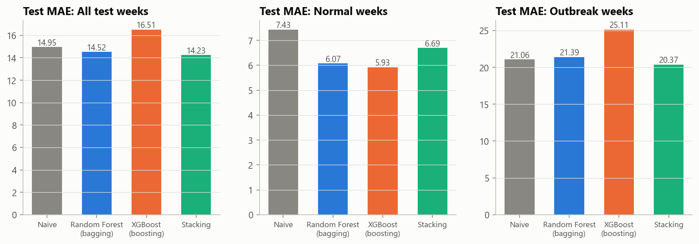

# Sri Lanka Dengue Early-Warning Dashboard: Ensemble Learning

**CM4371 Machine Learning & Pattern Recognition · Hands-on project · B. G. M. Prabuddhi**

**Live dashboard:** _LIVE_URL_PLACEHOLDER_ · **Video:** _VIDEO_URL_PLACEHOLDER_ ·
**Code:** https://github.com/BGMPrabuddhi/SriLanka-Dengue-Ensemble

## 1. The project

Dengue is one of Sri Lanka's largest public-health burdens: in the record year 2017 the Epidemiology Unit reported
**174,687 cases**, with **10,590 cases in a single week**. Case counts arrive every week for 26 health regions, but the
health ministry has to send fogging teams, hospital capacity and awareness campaigns *before* the next week's cases
appear.

This project **forecasts next week's dengue cases in every region** from recent case counts and lagged weather, turns
each forecast into a **Low / Medium / High risk level**, and compares **bagging, boosting, stacking and hybrid** ensemble
models to find out which approach is most reliable for this data, and **why** the models behave as they do. The results
are presented in an interactive Streamlit dashboard.

**Task.** Regression: standing at the end of reporting week *t*, predict the number of cases in week *t+1* for each of the
26 Regional Director of Health Services (RDHS) areas. Every model must beat the naive forecast *"next week = this week"*.

## 2. Data (real, Sri Lankan, public)

| Source | Content | Coverage |
|---|---|---|
| **denguedatahub** R package (Talagala, T. S.), dataset `srilanka_weekly_data`, compiled from the Weekly Epidemiological Reports of the Epidemiology Unit, Ministry of Health | weekly dengue cases for 26 RDHS areas | 23 Dec 2006 – 13 Sep 2026, 26,753 rows |
| **Open-Meteo Historical Weather API** (ERA5 reanalysis) | daily rainfall, mean temperature and relative humidity at each region's main town, aggregated to the reporting weeks | same period |

No API keys are needed; the `.rda` file is downloaded automatically and the weather response is cached in
`data/raw/weather.csv`.

**Cleaning.** District spelling variants were standardised (Kalmunai uses Ampara's coordinates for weather), two date
formats unified, and year/week rebuilt from the dates (the source labels are wrong around New Year).
**596 district-weeks (2.2%) were reporting errors** and were set to missing, never invented or re-assigned:

| Error type | Rule | Examples |
|---|---|---|
| Whole missing year | a region reports 0 for a full year but has cases in other years | Kilinochchi & Mullaitivu 2007–09, Monaragala 2020 |
| National reporting gap | ≥ 20 of 26 regions report 0 while nearby weeks have only a few | 10 Sep 2022 |
| Single-week dropout | 0 between two weeks with ≥ 10 cases | 25 district-weeks |
| Copied week | every region identical to the previous week | 21 Jan 2012, 18 Dec 2021, 8 Feb 2025, 22 Jun 2026 |
| Counts in the wrong regions | ≥ 4 small regions spike > 4× while large regions collapse | 30 Mar, 8 Jun and 7 Sep 2026 |

**Outliers.** 3.8% of district-weeks are extreme by a per-district IQR rule, but 77% of them fall in the epidemic years
2017, 2019, 2023 and 2026, and 79% occur while at least 3 regions are extreme in the same week. They are real outbreaks,
the very thing an early-warning system must learn, so they are kept; the skewed target is handled with a log1p transform.

**What the data shows.** Weekly cases are highly persistent (median lag-1 autocorrelation 0.89). The typical year peaks
around week 28 (South-West monsoon) with a second rise in December–January. Colombo, Gampaha and Kandy account for about
43% of all cases. After removing district averages, rainfall and humidity correlate most with cases **7–9 weeks later**
(rain → breeding sites → mosquito development → virus incubation in the mosquito and in people → reporting).

## 3. Method

* **Features** (per region, using only week *t* and earlier): cases in the last 4 weeks, 4- and 8-week rolling mean and
  standard deviation, a count of missing lag weeks, rainfall / temperature / humidity lagged 1–8 weeks, cyclical
  week-of-year, year and one-hot region (64 model columns). Gaps inside the lag window are forward-filled within the region.
* **Time-based split, no leakage:** train 2007–2021 (19,731 rows), validation 2022 (1,328), test 31 Dec 2022 –
  24 Aug 2026 (4,854). The latest weeks are excluded from testing because they may still be revised.
* **Tuning:** `RandomizedSearchCV` with `TimeSeriesSplit`; preprocessing inside sklearn `Pipeline`s; `random_state = 42`.
  Models are **selected on validation MAE**, never on test.
* **Target:** log1p(cases), chosen on validation MAE; predictions converted back with `expm1`.
* **Bagging** (reduces variance): bagged decision trees, Random Forest (with out-of-bag score), Extra Trees.
* **Boosting** (reduces bias): AdaBoost, Gradient Boosting, XGBoost, LightGBM, CatBoost, with early stopping on 2022.
* **Stacking:** Random Forest + XGBoost + LightGBM + CatBoost → RidgeCV meta-learner, trained on *time-ordered*
  out-of-fold predictions (sklearn's `StackingRegressor` does not accept `TimeSeriesSplit`); plus a `VotingRegressor`.
* **Hybrids:** (1) RF + SARIMA: SARIMA(1,0,1)(1,0,1)₅₂ chosen by AIC, a Random Forest models its residuals, walk-forward
  one-step-ahead on the national total and Colombo; (2) RF + ANN: an MLP (log-scaled inputs) combined with the forest by a
  validation-tuned weighted average, and by feeding the forest's forecast into the network.
* **Evaluation:** MAE, RMSE, R², sMAPE, % improvement over naive, and MAE split into **normal vs outbreak weeks**
  (actual cases above the region's training 75th percentile; 55% of the test weeks).

## 4. Results (test period 2023–2026)

### Bagging vs Boosting vs Stacking

| Strategy | Model | Test MAE | vs naive | Normal weeks | Outbreak weeks |
|---|---|---|---|---|---|
| Baseline | Naive (next week = this week) | 14.95 | — | 7.43 | 21.06 |
| Bagging | Random Forest | 14.52 | +2.9% | 6.07 | 21.39 |
| Boosting | XGBoost | 16.51 | −10.4% | 5.93 | 25.11 |
| **Stacking** | **RF + XGBoost + LightGBM + CatBoost → RidgeCV** | **14.23** | **+4.8%** | 6.69 | **20.37** |



### All models

| Family | Model | Test MAE | RMSE | R² | vs naive | Normal weeks | Outbreak weeks |
|---|---|---|---|---|---|---|---|
| Baseline | Naive (last week) | 14.95 | 37.59 | 0.867 | — | 7.43 | 21.06 |
| Baseline | Seasonal naive (last year) | 37.75 | 95.69 | 0.140 | −152.5% | 17.63 | 54.12 |
| Bagging | Extra Trees *(deployed)* | 14.51 | 39.09 | 0.857 | +3.0% | 6.20 | 21.26 |
| Bagging | Random Forest | 14.52 | 37.47 | 0.868 | +2.9% | 6.07 | 21.39 |
| Bagging | Bagged decision trees | 14.70 | 38.28 | 0.862 | +1.7% | 6.03 | 21.75 |
| Boosting | Gradient Boosting | 15.45 | 43.01 | 0.826 | −3.3% | 5.89 | 23.22 |
| Boosting | CatBoost | 15.71 | 44.10 | 0.817 | −5.1% | 6.14 | 23.50 |
| Boosting | AdaBoost | 16.02 | 47.36 | 0.789 | −7.2% | 6.33 | 23.90 |
| Boosting | XGBoost | 16.51 | 51.89 | 0.747 | −10.4% | 5.93 | 25.11 |
| Boosting | LightGBM | 18.59 | 50.95 | 0.756 | −24.4% | 5.98 | 28.85 |
| Stacking | Stacking → RidgeCV | 14.23 | 36.88 | 0.872 | +4.8% | 6.69 | 20.37 |
| Stacking | Voting (mean) | 15.61 | 43.19 | 0.825 | −4.4% | 5.87 | 23.53 |
| Neural net | ANN (MLP) | 17.44 | 65.87 | 0.593 | −16.7% | 6.89 | 26.02 |
| Hybrid | **RF + ANN, weighted 0.8 / 0.2** *(best on test)* | **14.19** | 36.89 | 0.872 | **+5.1%** | 6.00 | 20.85 |
| Hybrid | RF → ANN (forest forecast as input) | 16.38 | 53.63 | 0.730 | −9.5% | 6.45 | 24.45 |

| RF + SARIMA (MAE, cases/week) | Naive | SARIMA alone | RF alone | Hybrid |
|---|---|---|---|---|
| National total | 210.7 | 214.8 (−2.0%) | 248.4 (−17.9%) | **202.2 (+4.0%)** |
| Colombo | 58.1 | 60.5 (−4.1%) | 62.6 (−7.7%) | 62.0 (−6.6%) |

The deployed model (Extra Trees) was chosen in advance by the lowest 2022 validation MAE; the RF + ANN hybrid had the
lowest test error.

## 5. Why the models behaved this way

1. **The naive baseline is strong because dengue is persistent.** This week is the best single guide to next week, so
   recent case counts carry about 85% of every tree model's SHAP attribution (weather about 8%). Beating "same as last
   week" by a few percent is a real gain.
2. **Bagging reduces variance.** Averaging hundreds of deep, de-correlated trees cut validation error by 14–27% compared
   with a single tree. Forecasts are 17–19% more accurate than naive in normal weeks and level with naive in outbreaks,
   because an average of past similar weeks moves more slowly than a fast-rising epidemic. Random Forest also has the
   lowest time-series cross-validation error over 2007–2021 (13.56). Its out-of-bag R² (0.84, log scale) is optimistic
   compared with the time-ordered 2022 validation (0.75) because OOB samples random weeks inside the training period.
3. **Boosting reduces bias but under-forecast the outbreaks.** Boosted models were the most accurate in calm weeks
   (MAE 5.89–6.33) and the worst in outbreak weeks. The cause is the **log1p target**, not boosting itself: a model trained
   on log-cases predicts something close to a geometric mean, so `expm1` gives forecasts that are too low when values are
   large and volatile (Jensen's inequality). Trained on raw cases, XGBoost scores **14.37** (better than Random Forest) and
   LightGBM 14.60, instead of 16.51 and 18.59. Log1p was chosen correctly on the calm 2022 validation year, which hid this
   cost; it is reported here rather than switched after seeing the test set.
4. **Stacking helps only if base learners make different errors.** The four base models' validation errors are 98%
   correlated, so simple voting gained nothing (−4.4%). Stacking still came out best of the three strategies (+4.8%)
   because its RidgeCV weights (RF 0.37, XGBoost 0.40, CatBoost 0.25, LightGBM 0.02) sum to 1.05, which lifts forecasts and
   corrects part of the shared outbreak under-forecast.
5. **Hybrids work when their parts fail in different ways.** In outbreaks the forest forecasts too low while the neural
   network, which extrapolates, can over-shoot, so the 0.8 / 0.2 blend is the best model on test (+5.1%). SARIMA + RF beats
   naive on the national total (+4.0%) while each part alone does not. Feeding the forest into the network (RF → ANN)
   amplified errors instead (−9.5%).
6. **Record outbreaks and distribution shift.** The test years were outbreak-heavy (mean 52.6 cases per region-week vs
   29.9 in training). Trees cannot forecast above the values they were trained on, but only 0.4% of test weeks exceeded a
   region's training maximum; the bigger problem was that outbreak-level weeks were rare in training, so leaves average them
   with calmer weeks. Validation and test rankings agree only moderately (Spearman 0.74), so validation should span several
   seasons including an epidemic year.

## 6. Research notes

### Random Forest vs gradient boosting (XGBoost, LightGBM, CatBoost)

| | Random Forest (bagging) | XGBoost | LightGBM | CatBoost |
|---|---|---|---|---|
| How trees are built | deep trees in parallel on bootstrap samples with random feature subsets; averaged | shallow trees in sequence fitting the loss gradient; L1/L2 regularisation, second-order steps | same idea, leaf-wise growth on feature histograms | same idea, ordered boosting and symmetric trees |
| Main error reduced | variance | bias | bias | bias, with less over-fitting on small data |
| Tuning effort | low; more trees never hurt | high; needs early stopping | high; limit `num_leaves` | moderate; strong defaults |
| Categorical features | need encoding | need encoding | native | native (ordered target statistics) |
| In this project | most reliable single family (+2.9%) | best in calm weeks, hurt by the log target (−10.4%) | same pattern (−24.4%) | −5.1% |

### Tree ensembles on tabular vs image/text data
* **Tabular data (like this project):** columns are heterogeneous (counts, rainfall, a region, a week). Trees split one
  feature at a time, need no scaling, are robust to skew and outliers, capture interactions automatically, handle missing
  values and give feature importances and SHAP values. They still beat deep networks on typical medium-sized tabular data
  (Grinsztajn et al., 2022). Limitations: step-wise predictions, no extrapolation beyond the training range, no notion of
  time without hand-made lags, and large forests are big files.
* **Images and text:** meaning comes from local spatial or sequential patterns (edges, shapes, word order) that repeat
  anywhere in the input. CNNs and Transformers are built for this; single pixels or tokens carry little information on their
  own and inputs are very high-dimensional, so axis-aligned tree splits are inefficient. Trees remain useful on top of
  learned embeddings or for accompanying metadata.

## 7. Dashboard

Seven pages, ordered to answer *what is the problem → which approach worked best → why*:
**Home** (the problem, KPI cards, national trend with the 2017 record outbreak), **Model comparison** (bagging vs boosting
vs stacking, results grouped by family, % vs naive, normal vs outbreak errors, actual vs predicted, five-point "best and
why"), **District forecast & risk** (history, next-week forecast and risk badge, all 26 regions), **Hybrid models**,
**Explainability & what-if** (SHAP, feature importance, live sliders), **Data explorer** (filters, trends, district
totals, summary statistics) and **About**. Risk thresholds are each district's 50th / 75th percentile over the last 3
years. Forecasts are model estimates, not reported cases.

## 8. Limitations

One-week horizon only; the latest weeks may be revised by late reports; the source contains reporting errors that simple
rules may not all catch; no data on mosquito surveys, serotypes, population (cases are counts, not incidence) or human
movement; one weather point per region; models trained on 2007–2021 only; a single, outbreak-dominated test period.

## 9. Running the project

```powershell
git clone https://github.com/BGMPrabuddhi/SriLanka-Dengue-Ensemble.git
cd SriLanka-Dengue-Ensemble
python -m venv .venv                       # Python 3.12
.\.venv\Scripts\Activate.ps1               # macOS/Linux: source .venv/bin/activate
pip install -r requirements.txt            # dashboard
pip install -r requirements-dev.txt        # notebooks (optional)
copy .env.example .env                     # local settings (no secrets required)
streamlit run app/app.py
```
Notebooks `01` → `07` reproduce the whole pipeline (about 20 minutes). On Streamlit Community Cloud, select
**Python 3.12** so the saved models load with the pinned library versions.

```
├── app/app.py                Streamlit dashboard (UI)
├── .streamlit/config.toml    dashboard theme
├── src/                      backend: config, data, features, models, evaluate, hybrid, viz
├── notebooks/01 … 07         data & EDA → features → bagging → boosting → stacking → hybrids → final comparison
├── data/raw, data/processed  downloaded and cleaned data, feature table
├── models/                   saved models (.joblib), results.csv, predictions, summary.json
├── reports/figures/          figures used by the notebooks and dashboard
└── requirements.txt, requirements-dev.txt, .env.example
```

## 10. AI-use disclosure

Developed with the help of generative AI (Claude Code by Anthropic in VS Code; Claude chat for planning), which generated
most of the code, notebooks, dashboard and documentation. The student, B. G. M. Prabuddhi, chose the problem and data,
set the requirements, made or approved the data and modelling decisions, reviewed and ran all code, and interpreted the
results.

## References

Talagala, T. S., *denguedatahub* (R package) · Epidemiology Unit, Ministry of Health, Sri Lanka, *Weekly Epidemiological
Report* · Zippenfenig, P. (2023), *Open-Meteo.com Weather API*; Hersbach et al. (2020), ERA5, *QJRMS* 146 · Breiman (1996,
2001), Bagging; Random Forests · Geurts et al. (2006), Extremely randomized trees · Freund & Schapire (1997), AdaBoost ·
Friedman (2001), Gradient boosting · Chen & Guestrin (2016), XGBoost · Ke et al. (2017), LightGBM · Prokhorenkova et al.
(2018), CatBoost · Wolpert (1992), Stacked generalization · Zhang (2003), Hybrid ARIMA–neural network · Lundberg & Lee
(2017), SHAP · Grinsztajn, Oyallon & Varoquaux (2022), Why do tree-based models still outperform deep learning on tabular
data?
